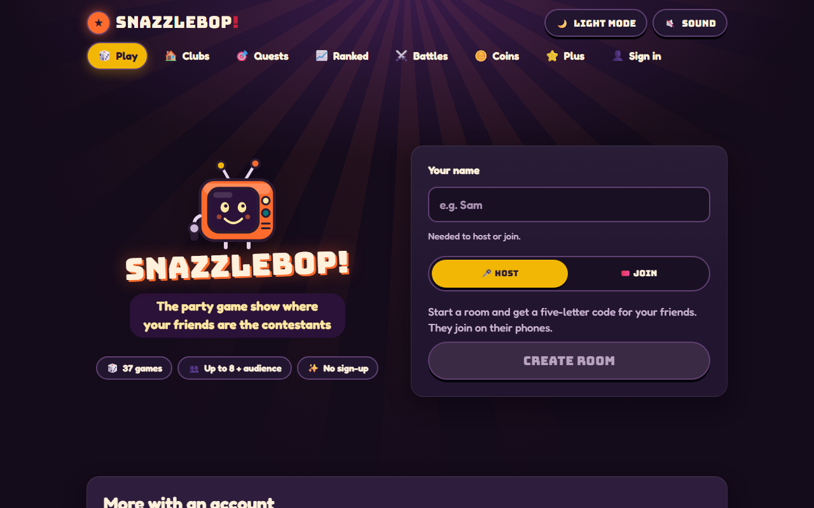
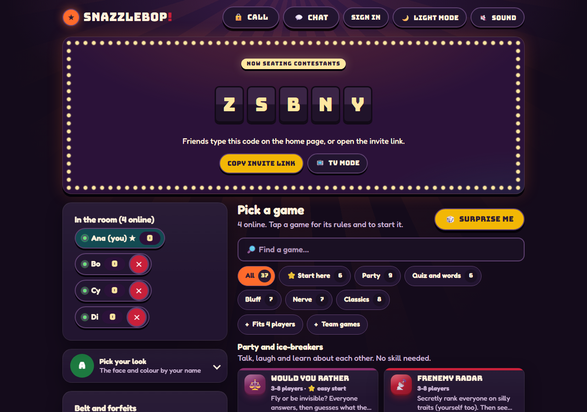
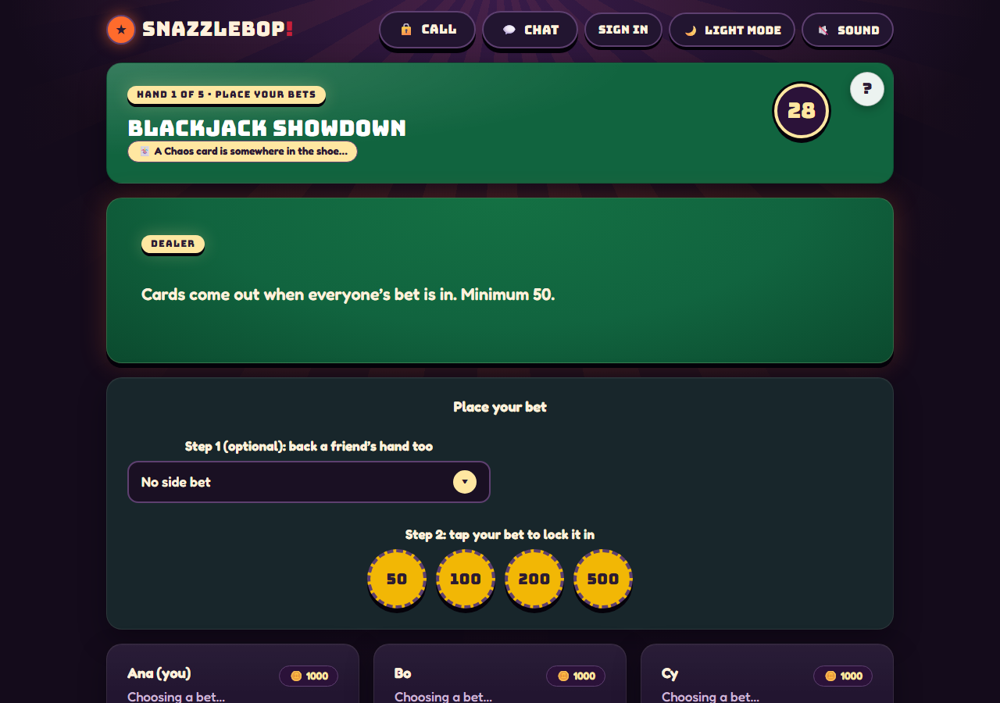
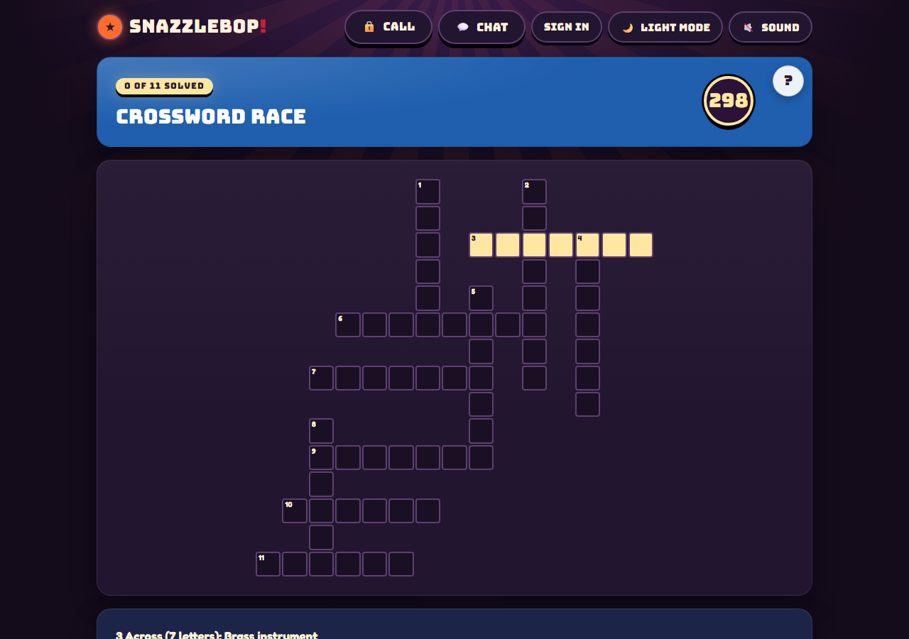
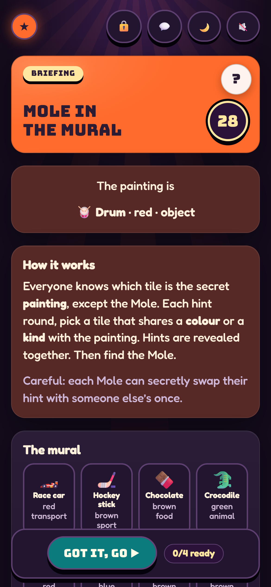
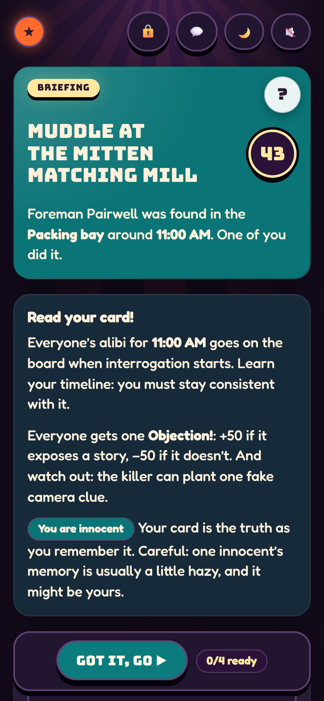
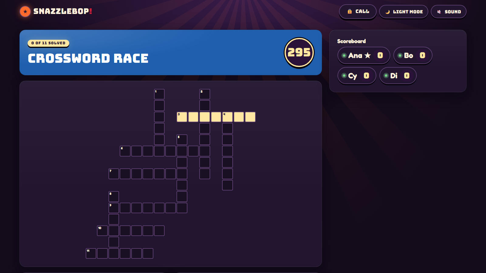

# Snazzlebop!

The party game show where your friends are the contestants. 1-8 players plus an audience, one room
code, no sign-up needed. Put the show on a TV and play from your phones.

**Live:** https://snazzlebop.onrender.com



## Games

**Game-show games**, playable on their own or as a show night:

| Game | Players | What happens |
| --- | --- | --- |
| **Trivia Tonight** | 1-8 | 1,300+ questions in 15 categories. Classic, fastest finger, survival, high stakes or category draft. |
| **Would You Rather** | 3-8 | One friend in the hot seat: answer the dilemma, then guess what they picked. |
| **Frenemy Radar** | 3-8 | Secretly rank everyone on flattering traits, then see your blind spot. |
| **Alibi** | 4-8 | A killer with a partly fake alibi hides among innocents. Question, object, vote. |
| **Price Is Weird** | 2-8 | Closest without going over, a sealed chaos spin, sabotage and a Showcase finale. |
| **Telepathy Tax** | 3-8 | Score for every mind that matches yours, unless too many do. |
| **Mole in the Mural** | 4-8 | Everyone knows the secret tile except the Mole. Hint, bluff, catch them. |
| **Blackjack Showdown** | 1-8 | The room against the dealer: side bets, a chaos hand and a tournament mode. |
| **Crossword Race** | 2-8 | A fresh grid every game. Race solo or in teams; buy a private letter. |
| **Liar's Dice** | 2-8 | Secret dice, public bids. Call "Liar!" or "Spot on!" |
| **Split or Steal** | 2-8 | Pair up over a pot: split, steal, and a Golden Pot finale. |
| **Chicken Run** | 2-8 | The pot climbs until a hidden bomb goes off. Cash out in time. |
| **Wager Wits** | 2-8 | Answer a number question, then bet on whose guess is closest. |
| **Code Crackers** | 2-8 | Hide a code, crack everyone else's with Mastermind clues. |
| **Roulette Royale** | 3-8 | One of you is secretly the House. Rig a spin, or call an audit. |
| **Lowest Lonely Number** | 2-8 | The lowest number nobody else picked takes the pot. |
| **Mystery Box Auction** | 3-8 | Bid on sealed boxes. One is a prize, two are bombs. |

**Classics**, with their original rules and our own names:

| Game | Like | Players |
| --- | --- | --- |
| **Truth or Dare** | Truth or Dare | 2-8 |
| **Word Race** | Wordle | 1-8 |
| **Last Card** | Uno | 2-8 |
| **Ludo** | Ludo | 2-8 |
| **Chess** | Chess (clocks, consultation teams) | 2-8 |
| **Draw & Guess** | Pictionary-style drawing (live canvas) | 2-8 |
| **Draw Telephone** | The drawing telephone game | 3-8 |
| **Property Tycoon** | The property-trading board game | 2-8 |
| **Mafia Night** | Mafia / Werewolf (hidden roles, night and day) | 4-8 |
| **Hot Potato Bomb** | Pass the bomb with a secret fuse | 2-8 |
| **Reaction Duel** | A reflex test with fake-outs | 2-8 |
| **Snakes and Ladders** | Snakes and Ladders | 2-8 |
| **Battleships** | Battleships (teams share a fleet) | 2-8 |
| **Four in a Row** | Connect Four (best of 3, teams take turns) | 2-8 |
| **Letter Lists** | Scattergories (one letter, six categories, the room judges) | 2-8 |
| **Hangman** | Hangman (everyone sets a word in turn) | 2-8 |
| **Five Dice** | Yahtzee (everyone plays their own card at once) | 1-8 |
| **On Your Head** | The forehead guessing game (tilt to answer) | 2-8 |
| **Imposter** | The word imposter game (one player has no word, or a close one) | 3-8 |
| **Codewords** | Two-team word association | 4-8 |

Many games have a **Teams** switch: two teams, combined scores, with official partner rules where the
original has them.

## Show nights and the room

- **Show night:** pick 2-6 games for one scoreboard, with the host's one-liners, a highlight reel,
  awards and an optional Jackpot finale.
- **Extras:** secret power cards, rivals, and a Friend Stock Exchange where everyone trades shares in
  each other.
- **Audience:** up to 30 more people can react, predict winners, trade and vote an MVP.
- **Chat:** an everyone channel plus a private team channel when there are teams.
- **Voice and video calls:** optional, through LiveKit, for signed-in accounts, with push-to-talk and
  a host "mute everyone".
- **Looks and walk-ons:** pick a face and a colour once; listed friends get a title card and a jingle
  when they join.
- **Friends:** add each other by username, see who is hosting and join with one tap.
- **Champion's belt and forfeit wheel:** the host crowns the night's leader, who wears a crown in
  that host's rooms until someone takes it; last place spins a wheel of forfeits the group wrote.
- **Recap picture:** the winner, the table, the best-liked drawing and a chat line as one image to
  share.
- **Installable:** add it to a phone's home screen and it opens full-screen.
- **TV mode:** a read-only big-screen view, with faces from the call and the latest chat.
- **Optional accounts:** coins for top places, a power-up shop, stats and monthly seasons. Sign-in by
  username or a confirmed email, an optional authenticator app, reset links by email, and branded
  emails about security changes and new devices (Resend or any SMTP server; off when unset).
- **Up for a game:** say you're free in a club for 30, 60 or 120 minutes; when three of you are up,
  the club hears about it and the first one in opens the room. Friends and clubmates see who's online.
- **Inbox and push:** an inbox for club games and room invites, plus Web Push on phones and desktops,
  with quiet hours, per-type switches, a daily cap and grouping. No push SDK and no third-party service.
- **Safety:** block (silent), report from a club or a room (the server attaches what was said), a
  moderators' queue per club with mute, remove, ban and escalate, an audit log, a privacy notice, and a
  download of your data.
- **Staff console:** platform staff (named in `STAFF_USERNAMES`, authenticator required) handle
  escalated club cases and reports outside clubs: dismiss, hand back to the club, or suspend an account
  (signed out everywhere, no sign-in until the date), with a staff audit log.
- **Places:** verify your college or company with a code sent to your address there (free email
  providers never count); a badge for a year, then alumni; clubs can be just for one place; staff
  manage places and see requests for new ones.
- **Ways to sign in:** username and password, an emailed link, or Google (when configured). A Google
  account can add a password later, and an existing account links Google from its account page.
- **Ranked play:** ten skill games can be played ranked (signed-in players, standard settings, no
  power-ups). Ratings use the Plackett-Luce model (as in OpenSkill), with placement games, tiers from
  Bronze to Diamond, eight-week seasons, and leaderboards for everyone, a club or a place, this season
  or this week. Fair-play limits stop repeat pairings and big swings in a day.
- **Clubs:** private groups (a hostel, a team, an office) with invite links, roles, club rules (which
  games, chat on or off) and club rooms that members can see and walk into.
- **Every device:** phones from 320 px up, tablets, laptops and TVs, in dark and light themes. Reduced
  motion, keyboard play, screen readers and 4.5:1 contrast are supported.

| Lobby | Blackjack | Crossword |
| --- | --- | --- |
|  |  |  |

| Mole in the Mural (phone) | Alibi (phone) | TV mode |
| --- | --- | --- |
|  |  |  |

## Tech

- **Backend:** FastAPI and WebSockets on Python 3.13. Game engines are pure Python and
  server-authoritative.
- **Frontend:** Vite, React and TypeScript, with hand-written CSS.
- **Hosting:** one Docker service serves both from the same origin, with Postgres (or SQLite locally)
  for accounts and room snapshots, so a restart or deploy doesn't end a game.

## Quick start

```bash
# API
cd backend && python -m venv .venv && source .venv/bin/activate
pip install -r requirements-dev.txt
uvicorn app.main:create_app --factory --reload --port 8000

# UI (another terminal)
cd frontend && npm install && npm run dev      # http://localhost:5173
```

Open the page in several browser windows (private windows count as different players).

## Configuration

Everything is read from the environment; [.env.example](.env.example) lists every setting with notes.

| Setting | Needed | What it does |
| --- | --- | --- |
| `ENV` | yes in production | `production` turns on the strict checks and headers |
| `SECRET_KEY` | yes in production | signs tokens and snapshots (long and random) |
| `ALLOWED_HOSTS`, `ALLOWED_ORIGINS` | yes in production | your domain(s) |
| `DATABASE_URL` | no | Postgres in production; SQLite by default |
| `CLIENT_IP_HEADER` / `TRUSTED_PROXY_HOPS` | behind a proxy | how to find the client's IP for rate limits |
| `ANTHROPIC_API_KEY` | no | grows the content pools with fresh, validated items |
| `LIVEKIT_URL`, `LIVEKIT_API_KEY`, `LIVEKIT_API_SECRET` | no | turns on voice and video calls |
| `GOOGLE_CLIENT_ID`, `GOOGLE_CLIENT_SECRET` | no | turns on sign in with Google (redirect URI `<PUBLIC_URL>/api/auth/google/callback`) |
| `JUMPSCARE_NAMES` | no | a private, comma-separated list of friends who get a walk-on and a jump scare |

## Integrations (reports)

Every report is a case with a public id (`rpt_...`), a priority, a timeline and versioned events, so
triage by a model, tickets in Jira or a support desk can be connected without code changes.

- **Webhook.** Set `REPORT_WEBHOOK_URL` and `REPORT_WEBHOOK_SECRET` (32+ characters). Every change to a
  case (`report.created`, `report.updated`) is POSTed as JSON: `{"id": <delivery id>, "topic": ...,
  "data": {...}}`, where `data` is the case (`"v": 1`; fields are only added within a version) plus
  `data.event` (`kind`, `actor`, `data`). Delivery is at least once, retried with growing waits for
  about three hours, so de-duplicate on `X-Snazzlebop-Delivery`. Verify `X-Snazzlebop-Signature`, which is
  `sha256=` + HMAC-SHA256(secret, `<X-Snazzlebop-Timestamp>.<raw body>`), and refuse old timestamps.
  People appear as pseudonymous refs (`usr_...`); emails never leave.
- **Integration API.** Set `INTEGRATION_TOKEN` (32+ characters) and send
  `Authorization: Bearer <token>`:
  - `GET /api/integrations/reports?status=open,triaged&limit=50`: cases by status
  - `GET /api/integrations/reports/{id}`: one case and its timeline
  - `POST /api/integrations/reports/{id}` with `source` (for example `jira` or `ai-triage`) and any of
    `status` (open, triaged, escalated, dismissed), `priority` (low, normal, high, urgent), `assignee`,
    `external` (`{"jira": {"key": "SNZ-12", "url": "https://..."}}`), `triage`
    (`{"label", "score", "summary"}`) and `note`. Updates go out as `report.updated` naming the
    `source`, so a system can ignore its own echoes.
  - `GET /api/integrations/health`: events waiting and events that gave up.
- Actions on people (mute, remove, ban) stay with human moderators; integrations suggest and track.

## Deploy

1. Push the repo to GitHub.
2. On Render, choose **New → Blueprint** and pick the repo. [render.yaml](render.yaml) creates the web
   service and a Postgres database, generates `SECRET_KEY` and sets the host allowlists.
3. Optional: in the service's **Environment** tab, add the optional settings above. They're
   dashboard secrets and never go in git.

Render sits behind Cloudflare, so `render.yaml` reads the client IP from `cf-connecting-ip`. On another
host, set `CLIENT_IP_HEADER` or `TRUSTED_PROXY_HOPS` to match your proxy.

## Development

```bash
cd backend && pytest && ruff check . && ruff format --check . && bandit -q -r app -c pyproject.toml
cd frontend && npm run typecheck && npm run build && npm run contrast
cd frontend && npm run e2e                 # Playwright against a running container on :10000
python scripts/simulate.py                 # bots play every game over real WebSockets
```

### Database migrations

The schema is managed with Alembic (`backend/app/migrations/`). The app applies new migrations itself at
startup, so a deploy needs no extra step. After changing a model in `app/db.py`:

```bash
cd backend
alembic revision --autogenerate -m "add clubs"   # writes app/migrations/versions/<rev>_add_clubs.py
alembic upgrade head                             # apply it to DATABASE_URL (default: local SQLite)
alembic downgrade -1                             # every migration must roll back cleanly
```

Review the generated file before committing. `tests/test_migrations.py` fails if the models and the
migrations drift apart, and CI runs it on SQLite and on Postgres.

### API contract

Every HTTP route declares its response model (`backend/app/schemas.py`). The OpenAPI document generated
from them is committed as `frontend/openapi.json`, and the web app's API types are generated from it
(`frontend/src/lib/api.gen.ts`, used through `src/lib/contract.ts`). After changing a route or a schema:

```bash
python scripts/export_openapi.py        # refresh frontend/openapi.json
cd frontend && npm run gen:api           # regenerate the TypeScript types
```

`tests/test_contract.py` calls every route and validates the real responses against their models; CI
fails if `openapi.json` or the generated types are out of date.

CI runs all of this on every push, plus:

- container, dependency and secret scans
- CodeQL
- Lighthouse
- an OWASP ZAP baseline
- an abuse and load suite

## Security

See [SECURITY.md](SECURITY.md) for how to report a vulnerability and how the app protects players.

## License

[MIT](LICENSE)
